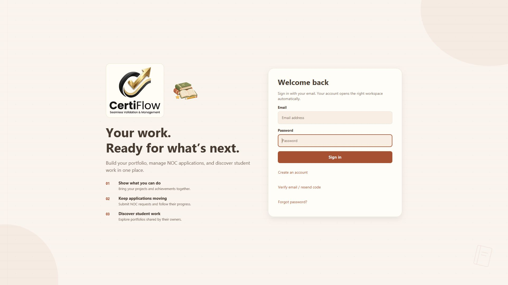

# Certiflow

A Java 17 / JavaFX desktop app for student portfolios, NOC approvals, private feedback and conversations. Recruiters and other viewers can explore work that students choose to share. Supabase provides PostgreSQL, authentication and file storage.

## Open the app

On the prepared PC, double-click **Certiflow** on the Desktop. It opens full screen; **Esc** leaves full screen and **F11** toggles it.

After changing source code, double-click `run.bat` to rebuild and open the app. The shortcut opens the existing compiled build. Keep `.tools/`, `lib/` and `target/classes/` in this prepared copy because the launcher uses them.

To recreate the Desktop shortcut, run from this folder with PowerShell 7:

```powershell
pwsh -NoProfile -File .\install-desktop-shortcut.ps1
```

## Run a fresh clone

Install Java 17 and Maven 3.9+. Copy `certiflow.properties.example` to `certiflow.properties` and enter your Supabase project URL and **publishable** key. Never put a secret or service-role key in the app. For a new database, follow [database setup](database/README.md); do not rerun initial migrations on an existing project.

```sh
mvn test
mvn javafx:run
```

The app needs an internet connection for account and record operations. UI tests need a graphical desktop session. This is a desktop application, not an Android or iOS package.

## Find your way around

| Location | Purpose |
| --- | --- |
| [User guide](documentation/USER_GUIDE.md) | Accounts, roles, NOCs, portfolios, remarks, chat and sharing |
| [Developer guide](documentation/DEVELOPMENT.md) | Code map, data flow, permissions, tests and how to change features |
| [Change history](documentation/CHANGELOG.md) | Completed changes and their validation |
| `src/main/java/com/certiflow/` | Java application code; start with `App.java` and `package-info.java` |
| `src/main/resources/` | Stylesheets, the original logo, app icons and academic artwork |
| `src/test/java/com/certiflow/` | Isolated data, interface and export tests |
| [database/](database/README.md) | Ordered migrations, access checks and email templates |
| [docs/](docs/README.md) | Public-link website served by GitHub Pages |
| [tools/art/](tools/art/README.md) | Artwork source and the sparkle animation generator |
| `build.bat`, `run.bat` | Build/test and launch helpers for the prepared Windows copy |

Use one sign-in page for every role. New accounts may choose Student or Recruiter / Viewer. Staff access comes from an administrator; only the founding administrator can appoint other admins. Private records and remarks are protected in the database, including when a client bypasses the interface.

## Checks and local files

On the prepared PC, `build.bat` runs the full test suite using the bundled offline cache; `build.bat compile` only compiles. A fresh clone uses `mvn test`. Tests use local fixtures and do not create accounts or messages in the live project.

Local configuration, preferences, downloaded documents, build output and diagnostics are excluded from Git. `data/` contains preferences and explicitly downloaded documents; preserve it when cleaning the project. `target/` and `logs/` are generated by builds. Screenshot output goes to ignored `previews/` only when requested. See the [developer guide](documentation/DEVELOPMENT.md) before deleting files from a prepared installation.


